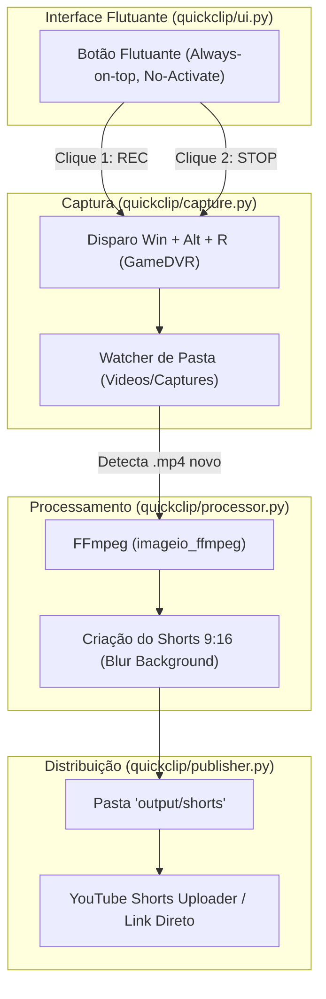

# QuickClip - Design Specification

**Data:** 2026-10-11  
**Autor:** Antigravity & Iury Almeida  
**Status:** Aprovado para Planejamento  

---

## 1. Visão Geral e Objetivo
O **QuickClip** é um aplicativo auxiliar e independente para gravação de jogadas (gameplay de Aion e outros jogos), conversão automatizada para o formato vertical de redes sociais (**YouTube Shorts 9:16**) e publicação/preparação para postagem.

O objetivo principal é oferecer fricção zero para o jogador: **literalmente um clique na tela para começar a gravar e outro clique para parar**, com todo o pipeline de edição e geração do Shorts rodando automaticamente em segundo plano.

---

## 2. Arquitetura do Sistema



### Componentes Principais:

### 2.1 Interface Flutuante (`ui.py`)
- **Tecnologia:** Python com `tkinter` + `ctypes` (Win32 API).
- **Estilo de Janela:**
  - `WS_EX_TOPMOST`: Sempre visível sobre o jogo.
  - `WS_EX_NOACTIVATE`: Não rouba o foco do jogo ao ser clicado, permitindo que o atalho de gravação do jogo seja disparado imediatamente no processo do Aion.
  - `WS_EX_TOOLWINDOW`: Não polui a barra de tarefas do Windows.
- **Visual:**
  - Design escuro obsidian / gamer minimalista.
  - Arrastável com botão esquerdo para qualquer canto da tela.
  - **Estado Parado:** `[ ⚪ REC ]` (fundo escuro translúcido, texto sutil).
  - **Estado Gravando:** `[ 🔴 00:00 ]` (círculo vermelho pulsante com cronômetro).
  - **Processando:** `[ ⏳ Gerando Shorts... ]`.

### 2.2 Motor de Captura (`capture.py`)
- Dispara a gravação nativa de hardware do Windows GameDVR (`Win + Alt + R`) via `ctypes.windll.user32.keybd_event` / `SendInput`.
- Aceleração por GPU com 60 FPS e captura de áudio direto do jogo sem perda de performance.
- Monitora a pasta oficial `C:\Users\iuryc\Videos\Captures` aguardando a finalização do arquivo `.mp4` (espera o arquivo ser liberado do lock de gravação).

### 2.3 Processador de Vídeo (`processor.py`)
- Utiliza o binário do **FFmpeg** já presente em `imageio_ffmpeg` (v7.1).
- Transforma a gravação horizontal (16:9) em vertical (9:16 - 1080x1920) ideal para Shorts/TikTok/Reels:
  - **Camada de Fundo:** O vídeo original esticado, recortado e desfocado (`boxblur` / `gaussian blur`), escurecido em 20%.
  - **Camada Central:** A gameplay original centralizada mantendo proporção 16:9 nítida.
- Renderização rápida com codec `libx264` e áudio `aac`.
- Destino: `quickclip/output/shorts/YYYY-MM-DD_HH-MM-SS_aion_short.mp4`.

### 2.4 Módulo de Publicação (`publisher.py`)
- Notificação na tela ou no próprio widget: "Shorts pronto!".
- Abre o diretório do vídeo pronto com 1 clique.
- Suporte para upload direto no YouTube Studio ou via API do YouTube Data v3.

---

## 3. Estrutura de Diretórios
```
quickclip/
├── docs/
│   └── superpowers/
│       ├── specs/
│       │   └── 2026-10-11-quickclip-design.md
│       └── plans/
│           └── 2026-10-11-quickclip.md
├── output/
│   └── shorts/
├── quickclip/
│   ├── __init__.py
│   ├── config.py
│   ├── ui.py
│   ├── capture.py
│   ├── processor.py
│   └── publisher.py
├── tests/
│   ├── test_config.py
│   ├── test_processor.py
│   └── test_capture.py
├── run.bat
├── requirements.txt
└── README.md
```

---

## 4. Tratamento de Erros e Casos de Borda
1. **Vídeo em uso pelo Windows:** O script aguarda até 5 segundos para o arquivo ser liberado pelo GameDVR antes de iniciar o FFmpeg.
2. **Gravação muito curta (< 2s):** O script ignora cliques acidentais e avisa o usuário.
3. **Resolução de Tela Variável:** O processador aceita qualquer resolução de entrada (1080p, 1440p, 4K) e padroniza para 1080x1920 (Full HD vertical).

---

## 5. Estratégia de Testes
- Teste unitário da montagem do comando de filtro complexo do FFmpeg (`[0:v]split...`).
- Teste de detecção de arquivos de vídeo e verificação de integridade.
- Teste interativo do widget sem roubo de foco.
